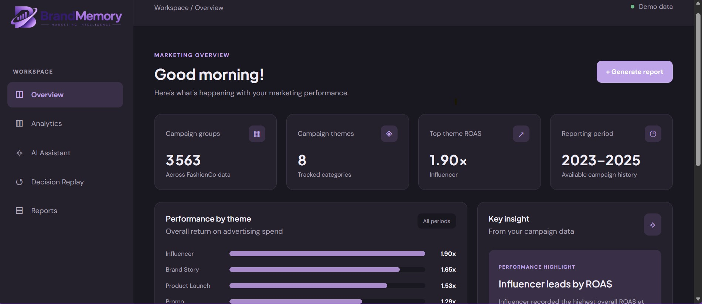

# BrandMemory — RAG-Powered Marketing Intelligence Platform

## Overview

BrandMemory is an AI-powered marketing intelligence platform combining Retrieval-Augmented Generation (RAG), LangChain, and business analytics to turn company documents and campaign data into actionable insights.

Built around a fictional fashion brand, FashionCo, it allows users to explore campaign performance, ask questions about business documents, retrieve relevant evidence, and revisit past marketing decisions through Decision Replay.

The project demonstrates a complete RAG workflow, from document processing and embeddings to semantic retrieval and LLM-powered answer generation.

**Note:** FashionCo is fictional, and its campaign dataset and some business documents contain synthetic data.

## 🖥️ Application Preview

## 🎥 LinkedIn Demo Video

[https://lnkd.in/p/ecVCfVQg](YOUR_LINKEDIN_DEMO_URL)

## Features

- RAG pipeline for retrieving information from business documents
- Document processing and text splitting using LangChain
- Semantic search with ChromaDB
- Text embeddings using Sentence Transformers
- Context-grounded answers generated with a local LLM
- Marketing campaign analytics and ROAS analysis
- Decision Replay with supporting evidence and experiment results
- Evidence quality assessment
- PDF marketing report generation
- Retrieval evaluation using Precision@5 and Recall@5

## Tech Stack

**Backend**
- Python
- FastAPI

**RAG & AI**
- LangChain
- ChromaDB
- Sentence Transformers (all-MiniLM-L6-v2)
- Qwen2.5:3b
- Ollama

**Data Analysis**
- Pandas

**PDF Generation**
- ReportLab

**Frontend**
- React
- Vite

## RAG Workflow

1. **Document Loading:** Load business documents from the document collection.
2. **Text Splitting:** Split documents into smaller chunks using LangChain.
3. **Embedding Generation:** Convert text chunks into vector embeddings using Sentence Transformers.
4. **Vector Storage:** Store embeddings and metadata in ChromaDB.
5. **Semantic Retrieval:** Retrieve relevant document chunks based on user queries.
6. **Answer Generation:** Send retrieved evidence to Qwen2.5:3b through Ollama to generate context-grounded answers.

## Future Improvements

- User authentication and personalized workspaces
- Conversation history and saved AI assistant sessions
- Export reports in additional formats (Excel, CSV)
- Document upload and management through the application interface

